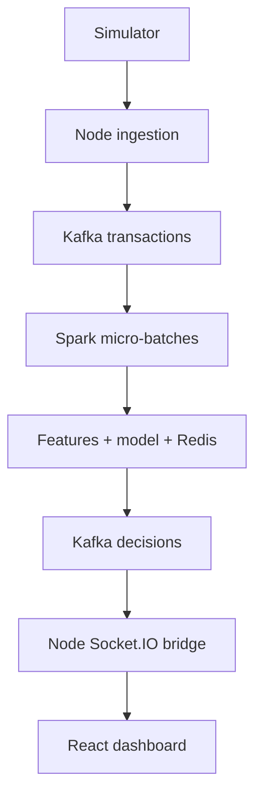

# Real-Time Payment Fraud Detection Pipeline

This is project **2 of 3** for the Software Engineer I portfolio: a simulated payment event flows through a Node ingestion API, Apache Kafka, PySpark Structured Streaming, a scikit-learn classifier, Redis-backed card history, a Kafka decision topic, Socket.IO, and a React operations dashboard. It does **not** authorize real payments. Identifiers are synthetic tokens, not card numbers.

## Start here

Prerequisites: Docker Engine + Compose v2, Python 3.9+ for the demo script, and enough free memory for Kafka and local Spark (about 4–6 GB recommended). The first processor start downloads the Spark Kafka connector from Maven and can take several minutes. Internet access is needed for Docker images, Python/Node dependencies, and this connector.

```bash
docker compose up --build -d
docker compose ps
docker compose logs -f processor
# In another terminal, once the API is ready:
python3 scripts/run_demo.py --cards 2 --per-card 80
```

Open `http://localhost:5173` to see the live dashboard. `http://localhost:3000/health` is the ingestion API health endpoint. The demo prints measured classification and latency numbers and saves a timestamped JSON report in `artifacts/`. Spark creates its model during the processor image build. Do not treat “container started” as proof that the first Kafka micro-batch has completed.

Run small local checks without Docker (requires `scikit-learn` and `joblib` for training):

```bash
python3 -m unittest discover -s tests -v
python3 processor/train.py --output artifacts
cd ingestion && npm install && npm test
cd ../dashboard && npm install && npm run build
```

To stop containers: `docker compose down`. To reset Kafka's local data and the persisted Redis/Spark state, use `docker compose down -v`; this removes local demo state.

## Trace one transaction end to end

1. `scripts/run_demo.py` generates synthetic histories. It inserts two bursts per card: unusually rapid purchases, a distant location jump, and elevated amounts. Legitimate transactions also occasionally have high amounts. Each event has a synthetic `groundTruth` label solely for evaluation; it is **not a model feature**.
2. The script sends each event to `POST /api/transactions` on the Node gateway. `validation.js` checks a token-shaped card ID, amount, two-letter country, coordinates, and an integer event timestamp. The server assigns a random `eventId` and server-side `ingestedAt` timestamp; its development-only switch allows the synthetic label into Kafka. It sends the event to Kafka with `cardId` as the key and returns **202 QUEUED** once the broker acknowledges the write. A 202 is not a fraud decision.
3. Kafka's `transactions` topic buffers events. This demo provisions **one partition**, making the offset order unambiguous for card histories. PySpark's `readStream.format("kafka")` reads that topic, decodes JSON to an explicit schema with `from_json`, and supplies one-second **micro-batches** to `foreachBatch`. Malformed records are sent to `invalid-transactions`.
4. For each valid record, `processor/features.py` combines the event with its Redis card history. It calculates: log amount, count in the last five minutes, distance from the prior location, implied speed, country change, and amount relative to that card's observed mean. State is retained across Spark micro-batches in Redis, so a burst spanning two batches is still counted.
5. A locally trained scikit-learn histogram gradient boosting classifier assigns a fraud probability. `APPROVED` is below 0.35, `REVIEW` is between 0.35 and the selected block threshold, and `BLOCKED` is above that threshold. Three high-risk decisions within two minutes additionally open a **five-minute card circuit breaker**. While it is open, subsequent events from that card are marked `BLOCKED`. The threshold comes from validation cards, not from the test set.
6. The processor atomically saves the updated card state and scored decision to Redis, then publishes the decision to Kafka's `fraud-decisions` topic. If Spark replays a micro-batch, a cached decision for the event ID is republished without changing card state a second time. Publishing and a Redis transaction are still **not one atomic transaction**; the consumer and UI deduplicate repeated event IDs while running.
7. The Node bridge consumes decisions, keeps a bounded in-memory recent feed, and sends each new decision to connected browsers with Socket.IO event `fraud:decision`. React initially fetches `GET /api/recent`, then adds new events as they arrive. The dashboard shows score, five-minute velocity, distance, circuit status, and `processedAt - ingestedAt` in milliseconds.
8. The demo compares observed `BLOCKED` decisions against the synthetic labels and writes `artifacts/live-run-<id>.json`. Review counts are shown separately; in the binary F1 calculation, only `BLOCKED` means predicted fraud.



### What the three timestamps mean

- `eventAt`: simulated merchant transaction time. The generated histories have fixed historical timestamps so their relative spacing and data are reproducible.
- `ingestedAt`: server clock when Node accepted the event.
- `processedAt`: processor clock after scoring. `processedAt - ingestedAt` measures **ingestion to decision**, including Kafka and Spark scheduling. It excludes decision-topic delivery, Socket.IO, and browser rendering; clocks must be synchronized if services run on separate hosts.

## Repository map

| File or folder | Purpose |
| --- | --- |
| `ingestion/src/server.js` | Input API, Kafka producer/consumer, Socket.IO, recent feed |
| `ingestion/src/validation.js` | Restrict inputs to synthetic card tokens and sane values |
| `processor/generate.py` | Seeded labeled synthetic histories |
| `processor/features.py` | Identical feature engineering in training and streaming |
| `processor/train.py` | Card-disjoint train/validation/test, threshold selection, model artifact, score report |
| `processor/stream.py` | PySpark streaming read, Redis state, model scoring, Kafka decisions |
| `dashboard/src/main.jsx` | Live monitoring UI |
| `scripts/run_demo.py` | Send examples, wait for decisions, calculate live numbers |
| `tests/` and `ingestion/test/` | Feature and input validation checks |
| `artifacts/evaluation.json` | Recorded offline synthetic test result |

## How the measured score was produced

`python3 processor/train.py --output artifacts` generates 120 card histories × 90 events = **10,800 events** with seed 2026. Each card has ten injected fraud events. Card IDs are assigned by modulo 20 to **7/10 training**, **3/20 validation**, and **3/20 test**; no card appears in more than one split. This yields 7,560 training events, 1,620 validation events, and 1,620 test events. The model sees six numeric behavioral features and never reads `groundTruth`.

The program trains `HistGradientBoostingClassifier`, tries block thresholds from 0.05 to 0.99 on validation cards, accepts thresholds with validation false-positive rate ≤ 0.5%, and selects the highest validation F1 (ties choose the higher threshold). It then evaluates **once on held-out test cards**. In the included run, the selected threshold was **0.99**. The saved `artifacts/evaluation.json` records the complete confusion matrix and metrics.

| Held-out synthetic test measurement | Value |
| --- | ---: |
| True positives | 179 |
| False negatives | 1 |
| False positives | 0 |
| True negatives | 1,440 |
| Precision | 1.0000 |
| Recall | 0.9944 |
| F1 = 2 × precision × recall / (precision + recall) | **0.9972** |
| False-positive rate = FP / (FP + TN) | **0.0000** |

These numbers are **for the deliberately generated patterns**, not evidence of fraud-detection quality on real cards. In particular, the injected travel/velocity bursts are easier to distinguish than many real attacks, and the generator family is shared between splits even though cards are distinct. The proposed résumé figure of **94.6% F1** is therefore neither reproduced nor adopted. To support a real-world claim, use a representative, permissioned dataset, temporal and entity leakage controls, calibration, subgroup analysis, and out-of-time validation.

The live demo's output is a **separate measurement**. It includes circuit-breaker overrides and streaming effects, so its confusion matrix can differ from the offline model score.

## Throughput and latency: what is and is not measured

`scripts/run_demo.py` reports API ingestion events per second for its sequential sender, decision coverage, and p50/p95 ingestion-to-Spark-decision latency. It waits for the decisions up to `--timeout` seconds, fails if any are missing, and writes raw numbers to JSON. The dashboard shows individual ingestion-to-decision times. To investigate scheduling, inspect `docker compose logs processor` and the Spark streaming progress output.

**5,000 events/s and <45 ms end-to-end latency are not claimed.** This implementation uses one Kafka partition, one local Spark driver, a one-second micro-batch trigger, per-event Redis/model work, and synchronous Kafka publishing. A 45 ms end-to-end target conflicts with the micro-batch schedule alone. Achieving very low-latency authorization would require a dedicated online scoring path; Spark can remain useful for feature aggregation, training, or less time-sensitive monitoring. A serious throughput test also needs sustained load, warm-up, fixed hardware, broker lag, percentile measurements at browser delivery, and loss/duplication checks.

**“Instantly block” is not claimed either.** The simulated circuit breaker changes decisions once its event reaches a Spark batch; it does not stop a real authorization at the payment network. The dashboard is an observer, not an authorization gate.

## API example

```bash
curl -i -X POST http://localhost:3000/api/transactions \
  -H 'Content-Type: application/json' \
  -d '{"cardId":"tok-demo-001","amount":125.30,"country":"IN","lat":12.97,"lon":77.59,"eventAt":1700000000000}'
curl -s http://localhost:3000/api/recent
```

The demo API has no login and Kafka uses plaintext **only on a local development network**. It accepts no raw PAN/card number format. Production work would require strong service authentication, TLS, encrypted storage, a governed feature store, privacy controls, model monitoring, alert routing, and a transactionally sound delivery/outbox design. Redis expiry is seven days; its card state and deduplication expire, so after long retention gaps/restarts these guarantees need redesign.

## Interview explanation (90 seconds)

“I built a simulated payment pipeline. Node validates transactions and publishes them to Kafka. PySpark reads Kafka in micro-batches and builds behavior features, with Redis carrying each card's recent history across batches. The classifier produces a probability, and a small circuit-breaker rule escalates repeated high-risk activity. Decisions go back to Kafka, then a Node consumer broadcasts them through Socket.IO to React. I trained and tested on disjoint synthetic card IDs and documented the exact confusion matrix. The synthetic score is a demonstration of measurement, not a claim about production fraud. I also measured live pipeline delay separately because Spark micro-batches do not support a credible 45 ms authorization claim here.”

## Primary references

- [Apache Spark Structured Streaming guide](https://spark.apache.org/docs/3.5.6/structured-streaming-programming-guide.html)
- [Spark Kafka integration](https://spark.apache.org/docs/3.5.8/structured-streaming-kafka-integration.html)
- [Apache Kafka container example](https://github.com/apache/kafka/blob/trunk/docker/examples/docker-compose-files/single-node/plaintext/docker-compose.yml)
- [Socket.IO event broadcasting](https://socket.io/docs/v4/broadcasting-events/)
- [scikit-learn F1 definition](https://scikit-learn.org/stable/modules/generated/sklearn.metrics.f1_score.html)
